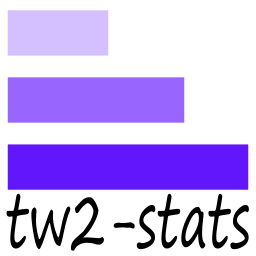

`tw2-stats` is a tool that provides statistics for the online browser game "Tribal Wars 2". You can find a working version of the tool at: [tw2-stats.com](https://tw2-stats.com/). For information about how to set it up locally visit our [wiki page](https://github.com/VMormoris/tw2-stats/wiki).<br>

> [!NOTE]
> _Although I'm not against people using it locally for themselves. I will highly encourage you to either help me host it or host it yourself so other community members can benefit from it as well._

__* tw2-stats is not associated with or endorsed by InnoGames.__

## Development
Copy your environment variables example files, and fill in the passwords on `docker/.env`
```sh
cp .env.example .env
cp docker/.env.example docker/.env
```
> [!TIP]
> If your user and group ids (`id -u` and `id -g`) aren't 1000, set `UID` and `GID` in `docker/.env` to them. Otherwise the files the containers write in the repository won't be owned by you, and the app won't be able to write to `storage/`.

Useful `docker` commands:
```sh
docker compose build # Rebuild custom images (only app for now)
docker compose run --rm --no-deps -u "$(id -u):$(id -g)" -e COMPOSER_HOME=/tmp/composer app composer install # Installs Laravel dependencies
docker compose run --rm --no-deps -u "$(id -u):$(id -g)" app php artisan key:generate # Generates random key for your app
docker compose run --rm node npm ci # Installs all front-end dependencies from scratch
docker compose run --rm node npm run build # Builds the front-end assets
docker compose run --rm --service-ports node npm run dev # Starts the vite development server, with hot reload
docker compose up -d # Starts app and postgres containers in the background
```
The site is served at http://127.0.0.1:8000, PostgreSQL at `127.0.0.1:5432`, and Vite at `127.0.0.1:5173`.


## Contributing
* _For reporting a bug please open an issue describing the bug._
* _If you want to contribute or suggest a new feature open an issue describing what you want._
* _Feel free to work to any of the open issues and make a pull request._

## Third Party Tools
* [PostgreSQL](https://www.postgresql.org/)
* [Apache2](https://httpd.apache.org/)
* [Vite](https://vite.dev/)
* [Laravel](https://laravel.com/)
* [laravel-cte](https://github.com/staudenmeir/laravel-cte)
* [Vue3](https://vuejs.org/)
* [Bootstrap](https://getbootstrap.com/)
* [vue-chartjs](https://vue-chartjs.org/)
* [ChartJS](https://www.chartjs.org/)
* [ForkAwesome](https://forkaweso.me/Fork-Awesome/)

If you want to **keep up with changes** or if you have **questions** that don't require opening issue come and join our [discord server](https://discord.com/invite/vxZbCrShaP).
